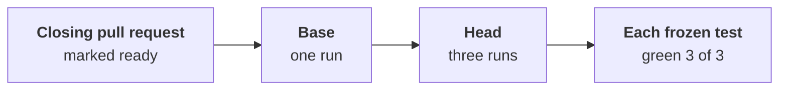

# The green proof: three runs out of three

Part of [the tester](../README.md). Step 5 of
[ADR-0055's plan](../../../docs/adr/0055-the-tester-writes-the-acceptance-tests-before-the-code.md#build-plan):
a test that passes once and fails the next time proves nothing.

## When it runs

- **Where the frozen guard runs**: the tester routed on
  `merge-request`, no agent, on the pull request that merges the tests:
  - **the developer's**, or any saying `Closes #<n>`: the record is
    read from the tester's open Draft of `#<n>`
    ([#1281](https://github.com/JN0V/workline/issues/1281));
  - **its own Draft**, branch `workline/tester/issue-<n>`
    ([hand-over](hand-over.md)), when a person builds on it.
  - **closing several issues**: each Draft's record is guarded, and
    their tests proven together; an objection goes on the Draft's
    line, where the tester answers.
  - No open Draft for the issues it closes: nothing to guard, said.
  - A forge that lists no merge request: the Drafts not read, a
    warning, `drafts-unread`.
- **Once the pull request is marked ready**: the developer opens it so
  when green. While it is a Draft, the tests are meant red; the proof
  says it waits.
- **Proven once**: the Draft stays a Draft under the developer's pull
  request; once that merges, the Draft is closed, never proven twice.
- **After the guard**: a test changed by another blocks first; the
  proof waits for the tests as the tester wrote them.

## What it runs

- **The tests required**: the ids the tester's record keeps, found new
  by its red proof, never "the head's tests the base lacks": a change
  to a build file or a filter that stops one running blocks, named
  ([ADR-0065, change 2](../../../docs/adr/0065-code-only-what-converges-language-knowledge-in-packs.md#2-scope-as-paths-a-hint-not-a-fence)).
  - **An id from a report** must be in each head run, green.
  - **A test whose build broke on the base** is kept as `file:name`:
    no report named it yet. A head id holding that name as a whole
    part is it (`calc.Name`, `Name[1]`, `Name/case`), qualified by:
    - the file's folders (a Go package), or
    - the file, after its last folders or nothing (`tests.test_x`), or
    - a class named after the file whose package leaves the folders
      aside (Kotlin, C#).
    - Not it: a nested folder's `Name` (`calc/sub.Name`), or one of a
      same-named folder elsewhere (`app/cmd/calc.Name` for
      `internal/calc`).
  - **A test kept as its file alone** (its build broke, no
    `test-name` to name it,
    [#1293](https://github.com/JN0V/workline/issues/1293)): met by a
    head id of that file, its name after its last folders or nothing
    (`test_mul.main`, `tests.test_mul` for `tests/test_mul.c`); none,
    `frozen-test-missing`, or the judge's beside other new tests.
  - **A record with no class, failed, on the red run** is kept marked
    `errored`: maybe the runner's record of a file it could not collect
    (pytest's collection error), not a test case. Gone on the code, it
    goes to the judge too. So is one red by an error, its name in none
    of the tester's files, alone in its suite; beside the suite's
    tests, it is not frozen at all
    ([#1325](https://github.com/JN0V/workline/issues/1325)).
  - **Not found by that name, while the head has other new tests**: the
    match is a guess, so the judge decides
    ([rule A](../../../docs/adr/0065-code-only-what-converges-language-knowledge-in-packs.md#rule-a-a-guess-may-only-pass)).
    - It reads the ids, the head's new tests, the frozen files, and the
      change beside them (build and runner files among it).
    - "Ran under another name" (a display name): passes, said.
    - "Dropped": `frozen-test-missing` blocks.
    - Unsure, failed, or no agent: `frozen-unproven`, a warning for a
      person.
    - Either way it is written on the pull request, in the tester's
      comment there.
  - **No new test the head could run it as**: it blocks, no judge.
  - **A record written before the ids were kept**: the head's tests
    the base lacks, as before, said by `frozen-ids-unknown`.
  - **A rewrite on an objection** moves the ids: the file's old ones,
    from one run of the base with the file as frozen, come off; the
    rewrite's go on.
- **The base once**: the merge base of the record's base and the head,
  to tell the builder's own new tests (required green too) from the
  base's.
  - **Its test ids alone are read**, so a run of the same tree is
    reused ([#1338](https://github.com/JN0V/workline/issues/1338)):
    - the ids a run found are kept in the main clone's
      `.git/workline/test-ids/`, keyed by the tree's hash, the command
      and the report;
    - kept only when the command exited 0, its report read: the whole
      suite ran;
    - written by each run of a clean tree: the tester's red proof on
      the base, the head's first run here (merged up to date, its tree
      is the next base);
    - found, the base is not run again, said on the run's error output;
      the head's three runs always are.
    - A fresh clone keeps none: the base runs.
  - **In CI**, the templates carry the folder from the tester's run to
    each pull request's guard, and to its next push, where no other
    branch writes ([#1407](https://github.com/JN0V/workline/issues/1407)):
    GitHub's cache, GitLab's artifacts
    ([GitHub](../../../docs/github/jobs.md),
    [GitLab](../../../docs/gitlab/template.md)); never a run where the
    developer ran. A file of another tree, command or report is not read.
- **The head three times**, one run after the other, in one fresh
  checkout. Each run is `test-command`, its report read as JUnit XML,
  stopped at `suite-max-seconds`, its last lines said
  ([#1425](https://github.com/JN0V/workline/issues/1425)).
- **Never again until green**: three runs, not "until it passes".
- **Why one checkout**: a second run there reuses the runner's build
  cache. On a copy of workline, a Go package: 4.5 s the first run,
  1 s each next one; the whole proof about 10 s, not 22 s.
- **A test that a run before it breaks** (a file it leaves, a port it
  holds) fails on a person's second run too: it counts as flaky.

## What it says

| Finding | Blocks | When |
|---|---|---|
| `test-flaky` | yes | a new test passed in some runs, not all: the runs it was red in are named |
| `test-flaky` | no, warns | a test the base already had is flaky here: not the change's |
| `frozen-test-missing` | yes | a test of the record is in none of the three runs: its id is named; for a `file:name` beside other new tests, only on the judge's "dropped" |
| `frozen-test-judged` | no, informs | the judge says a `file:name` test ran under another name |
| `frozen-unproven` | no, warns | the judge did not tell, or no agent: a person reads the change |
| `test-red-on-head` | yes | a frozen or new test is red, skipped or missing in each of the three runs |
| `frozen-ids-unknown` | no, warns | an older record names files, not tests: the head's new tests are taken |
| `no-new-test` | yes | an older record, and the head's reports name no test the base's does not |
| `setting-missing`, `report-missing` | yes | no command, or a run wrote no report |

- **A flaky test of the tester's**: find the cause in the code first;
  a test that cannot hold, object on its line
  ([the form](../README.md#frozen-tests-and-objections)).
- **A flaky test the base had**: the ecosystem's skip and an issue
  naming it, never deleted
  ([ADR-0055](../../../docs/adr/0055-the-tester-writes-the-acceptance-tests-before-the-code.md#job-2-the-corpus-curator)).

## A bug's parent

[#1212](https://github.com/JN0V/workline/issues/1212): what a person
in QA does, rerunning the reproduction once the fixes merged.

- **Before the split**: a bug goes to its tests first. The tester
  writes the reporter's symptom as red tests on the bug's Draft; the
  line then asks the product owner its split, before the developer
  ([split](../../../docs/spec/backlog-acts/split.md#split-on-size)).
- **Once every part is closed**, no person's yes on it: the line runs the tester on the
  parent, no agent, given `symptom`, before the product owner.
  - The Draft's test files, as its commits changed them since the
    record's base, are merged over the default branch's current commit.
  - The green proof runs there: the record's tests, three runs out of
    three.
- **What it says**: one comment on the parent,
  `<!-- workline:sticky=tester/symptom -->`: green, the tests and the
  commit named; or why not.
  - No open Draft of the parent: no test of its own.
  - Its tests do not merge over the branch, or are red, flaky or
    missing: not proven, the first finding said.
  - The branch's commit is fetched from `origin`; a fetch that fails is
    no proof, never the clone's own copy, maybe behind.
  - A tester's run that fails leaves its older comment: the product
    owner reads one older than the run as no proof.
- **What follows**: green, the parent is closed alone past `cautious`;
  else its closing stays a person's
  ([a bug's parent](../../../docs/spec/backlog-acts/parent.md)).

## Random order, by ecosystem

A test that passes only after another is flaky too. Three runs in a
random order each find it more often. Put the runner's option in
`test-command`; it does no harm to the red-first check.

| Runner | Random order |
|---|---|
| Go | `-shuffle=on` |
| pytest | `-p randomly`, with pytest-randomly |
| Jest | `--randomize` |
| cargo nextest | none built in |
| Maven Surefire | `-Dsurefire.runOrder=random` |

- **Go**: `gotestsum --junitfile {report} -- -shuffle=on ./...`
- **Go's result cache**: Go would replay the first run's pass in the
  next ones. Each run gets `-count=1` in `GOFLAGS`, unless the project
  set a `-count` there; other runners ignore it.
- **The job's environment, not the line's**: the runs never see the
  line's own variables ([the list](../../../docs/environment.md#the-lines-own)):
  its forge calls' wait, `WORKLINE_RATE_WAIT`
  ([#940](https://github.com/JN0V/workline/issues/940)), nor its runs'
  folder, `WORKLINE_RUNS_DIR`, where a suite's engines would prune the
  live run ([#953](https://github.com/JN0V/workline/issues/953)).
