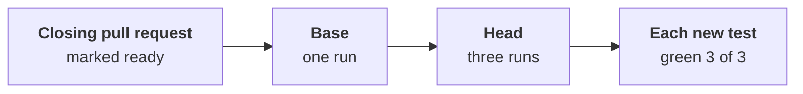

# The green proof: three runs out of three

Part of [the tester](../README.md). Step 5 of
[ADR-0055's plan](../../../docs/adr/0055-the-tester-writes-the-acceptance-tests-before-the-code.md#build-plan):
a test that passes once and fails the next time proves nothing.

## When it runs

- **Where the frozen guard runs**: the tester routed on
  `merge-request`, on its own branch `workline/tester/issue-<n>`
  ([hand-over](hand-over.md)). No agent.
- **Once the pull request is marked ready**: the builder marks it so
  when it closes the issue. While it is a Draft, the tests are meant
  red; the proof says it waits.
- **After the guard**: a test changed by another blocks first; the
  proof waits for the tests as the tester wrote them.

## What it runs

- **The base once**: the merge base of the record's base and the head.
  The new tests are those the head's reports hold and the base's does
  not, the builder's own new tests too.
- **The head three times**, one run after the other, in one fresh
  checkout. Each run is `test-command`, its report read as JUnit XML.
- **Never again until green**: three runs, not "until it passes".
- **Why one checkout**: a second run there reuses the runner's build
  cache. On a copy of workline, a Go package: 4.5 s the first run,
  1 s each next one; the whole proof about 10 s, not 22 s.
- **A test that a run before it breaks** (a file it leaves, a port it
  holds) fails on a person's second run too: it counts as flaky.

## What it says

| Finding | Blocks | When |
|---|---|---|
| `test-flaky` | yes | a new test passed in some runs, not all: the runs it was red in are named |
| `test-flaky` | no, warns | a test the base already had is flaky here: not the change's |
| `test-red-on-head` | yes | a new test is red, skipped or missing in each of the three runs |
| `no-new-test` | yes | the head's reports name no test the base's does not |
| `setting-missing`, `report-missing` | yes | no command, or a run wrote no report |

- **A flaky test of the tester's**: find the cause in the code first;
  a test that cannot hold, object on its line
  ([the form](../README.md#frozen-tests-and-objections)).
- **A flaky test the base had**: the ecosystem's skip and an issue
  naming it, never deleted
  ([ADR-0055](../../../docs/adr/0055-the-tester-writes-the-acceptance-tests-before-the-code.md#job-2-the-corpus-curator)).

## Random order, by ecosystem

A test that passes only after another is flaky too. Three runs in a
random order each find it more often. Put the runner's option in
`test-command`; it does no harm to the red-first check.

| Runner | Random order |
|---|---|
| Go | `-shuffle=on` |
| pytest | `-p randomly`, with pytest-randomly |
| Jest | `--randomize` |
| cargo nextest | none built in |
| Maven Surefire | `-Dsurefire.runOrder=random` |

- **Go**: `gotestsum --junitfile {report} -- -shuffle=on ./...`
- **Go's result cache**: Go would replay the first run's pass in the
  next ones. Each run gets `-count=1` in `GOFLAGS`, unless the project
  set a `-count` there; other runners ignore it.
