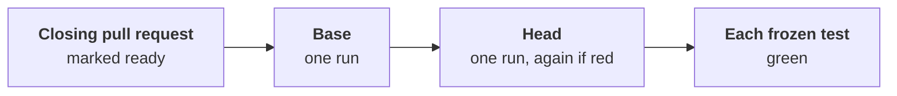

# The green proof: each frozen test green on the head

Part of [the tester](../README.md). Step 5 of
[ADR-0055's plan](../../../docs/adr/0055-the-tester-writes-the-acceptance-tests-before-the-code.md#build-plan):
a test that passes once and fails the next time proves nothing.

## When it runs

- **Where the frozen guard runs**: the tester routed on
  `merge-request`, no agent, on the pull request that merges the tests:
  - **the developer's**, or any saying `Closes #<n>` or `Part of #<n>`: the record is
    read from the tester's open Draft of `#<n>`
    ([#1281](https://github.com/JN0V/workline/issues/1281));
  - **its own Draft**, branch `workline/tester/issue-<n>`
    ([hand-over](hand-over.md)), when a person builds on it.
  - **closing several issues**: each Draft's record is guarded, and
    their tests proven together; an objection goes on the Draft's
    line, where the tester answers.
  - No open Draft for the issues it closes: nothing to guard, said.
  - A forge that lists no merge request: the Drafts not read, a
    warning, `drafts-unread`.
- **Once the pull request is marked ready**: the developer opens it so
  when green. While it is a Draft, the tests are meant red; the proof
  says it waits.
- **Proven once**: the Draft stays a Draft under the developer's pull
  request; once that merges, the Draft is closed, never proven twice.
- **After the guard**: a test changed by another blocks first; the
  proof waits for the tests as the tester wrote them.

## What it runs

- **The tests required**: the ids the tester's record keeps, never "the
  head's tests the base lacks": a change that stops one running blocks,
  named ([which ids](green-proof-tests.md)).
- **The base once**, only to tell the builder's own new tests from the
  base's; a run of the same tree is reused
  ([how](green-proof-runs.md#the-base-once)).
- **The head once**, in one fresh checkout, again only when a test is
  red, to tell flaky from red ([how](green-proof-runs.md#the-head-and-again-when-red)).
- **The tests' folders alone**, when `draft-command` names
  `{packages}`: the base and the head run it on the folders holding
  the tester's test files, said by `proof-scope`; else `test-command`
  runs whole ([how](green-proof-runs.md#the-head-and-again-when-red)).

## What it says

| Finding | Blocks | When |
|---|---|---|
| `test-flaky` | yes | a new test red in one run, green in the other: the run it was red in is named |
| `test-flaky` | no, warns | a test the base already had is flaky here: not the change's |
| `frozen-test-missing` | yes | a test of the record is in none of the runs: its id is named; for a `file:name` beside other new tests, only on the judge's "dropped" |
| `frozen-test-judged` | no, informs | the judge says a `file:name` test ran under another name |
| `frozen-unproven` | no, warns | the judge did not tell, or no agent: a person reads the change |
| `test-red-on-head` | yes | a frozen or new test is red, skipped or missing in both runs |
| `frozen-ids-unknown` | no, warns | an older record names files, not tests: the head's new tests are taken |
| `no-new-test` | yes | an older record, and the head's reports name no test the base's does not |
| `setting-missing`, `report-missing` | yes | no command, or a run wrote no report |
| `proof-scope` | no, informs | the proof ran the folders of the tester's tests alone, named |

- **A flaky test of the tester's**: find the cause in the code first;
  a test that cannot hold, object on its line
  ([the form](objections.md)).
- **A flaky test the base had**: the ecosystem's skip and an issue
  naming it, never deleted
  ([ADR-0055](../../../docs/adr/0055-the-tester-writes-the-acceptance-tests-before-the-code.md#job-2-the-corpus-curator)).

## A bug's parent

[#1212](https://github.com/JN0V/workline/issues/1212): what a person
in QA does, rerunning the reproduction once the fixes merged.

- **Before the split**: a bug goes to its tests first. The tester
  writes the reporter's symptom as red tests on the bug's Draft; the
  line then asks the product owner its split, before the developer
  ([split](../../../docs/spec/backlog-acts/split.md#split-on-size)).
- **Once every part is closed**, no person's yes on it: the line runs the tester on the
  parent, no agent, given `symptom`, before the product owner.
  - The Draft's test files, as its commits changed them since the
    record's base, are merged over the default branch's current commit.
  - The green proof runs there: the record's tests, green on it.
- **What it says**: one comment on the parent,
  `<!-- workline:sticky=tester/symptom -->`: green, the tests and the
  commit named; or why not.
  - No open Draft of the parent: no test of its own.
  - Its tests do not merge over the branch, or are red, flaky or
    missing: not proven, the first finding said.
  - The branch's commit is fetched from `origin`; a fetch that fails is
    no proof, never the clone's own copy, maybe behind.
  - A tester's run that fails leaves its older comment: the product
    owner reads one older than the run as no proof.
- **What follows**: green, the parent is closed alone past `cautious`;
  else its closing stays a person's
  ([a bug's parent](../../../docs/spec/backlog-acts/parent.md)).

## Random order, by ecosystem

A test that passes only after another is flaky too. A random order
finds it more often. Put the runner's option in
`test-command`, and in `draft-command` when the proof runs it; it does
no harm to the red-first check.

| Runner | Random order |
|---|---|
| Go | `-shuffle=on` |
| pytest | `-p randomly`, with pytest-randomly |
| Jest | `--randomize` |
| cargo nextest | none built in |
| Maven Surefire | `-Dsurefire.runOrder=random` |

- **Go**: `gotestsum --junitfile {report} -- -shuffle=on ./...`
- **Go's result cache**: Go would replay the first run's pass in the
  next one. Each run gets `-count=1` in `GOFLAGS`, unless the project
  set a `-count` there; other runners ignore it.
- **The job's environment, not the line's**: the runs never see the
  line's own variables ([the list](../../../docs/environment-roles.md#the-lines-own)):
  its forge calls' wait, `WORKLINE_RATE_WAIT`
  ([#940](https://github.com/JN0V/workline/issues/940)), nor its runs'
  folder, `WORKLINE_RUNS_DIR`, where a suite's engines would prune the
  live run ([#953](https://github.com/JN0V/workline/issues/953)).
