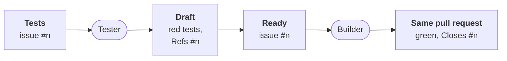

# The hand-over: what whoever builds finds

Part of [the tester](../README.md). The contract the developer
([ADR-0054](../../../docs/adr/0054-the-developer-takes-a-ready-issue-to-a-pull-request.md))
or a person reads before building a ready issue.

## What is there

- **The branch**: `workline/tester/issue-<n>`, the base plus the
  tester's commit of the tests. The tests are red there.
- **The Draft**: a pull request from that branch, opened by workline's
  account, titled `test: the acceptance tests of #<n>`.
  - It says `Refs #<n>`, never `Closes`: it does not count as a pull
    request closing the issue.
  - `## Tests`: a table, each scenario and the test that checks it;
    a scenario no test can check is listed as not tested, with why.
  - What the proof said: each test red on the base, by an assertion,
    a missing name the issue names, or a broken build the judge read.
    A test whose package did not build is named `file:name`, or by
    its file alone where no `test-name` names its tests, marked so
    ([how](missing-name.md)). **Red unproven**, when the judge did
    not settle it, is written on top, in the record, and on the
    developer's pull request.
  - Where it ran: with `draft-command` naming `{packages}`, the folders
    holding the tests alone, or their build modules with
    `module-files` set, said as `proof-scope`; else the whole
    suite ([#979](https://github.com/JN0V/workline/issues/979)).
- **The record**: workline's own comment on the Draft, marked
  `workline:tester-record`. It holds the issue, the base, each test
  file with its git blob, the test ids the red proof found new, and
  the scenarios as read. Only the tester's runs write it. The green
  proof requires each id on the code ([how](green-proof.md#what-it-runs)).

## When the tests are written

The issue waits for its tests labelled `workline:needs-tests`, set by
the product owner; an issue labelled ready by hand, with no Draft, is
taken too.

Routed on `issue` (`issue: [tester, developer]`), the issue line runs
the tester on it at once, and moves a ready issue whose scenarios no
Draft nor proof kind stands for back to its tests, by rule, said on it
([the line of states](../../../docs/spec/routing.md#the-line-of-states)).
Once the Draft is proven, the engine moves the issue on, no agent asked
([ADR-0059](../../../docs/adr/0059-an-issue-moves-by-its-state-each-step-wakes-the-next.md#3-tests-wakes-the-tester-its-result-makes-ready)):

- **Each scenario** has its row in `## Tests`, or its reason under
  not tested.
- **The project's lint** passes on the tests: each gate routed on
  `merge-request`, only what they add counted, and
  [the reviewer's rules](../../reviewer/README.md) when it is routed
  there: a test once frozen is no longer the tester's to edit
  ([#1040](https://github.com/JN0V/workline/issues/1040)). A finding there is the
  agent's to mend: it is asked once more, each finding named by its file
  and line
  ([#964](https://github.com/JN0V/workline/issues/964)). Still there,
  the run blocks (`tests-lint`): no Draft, the issue keeps its state,
  the finding said on it. A lint's error repeating the build's own
  error the test is red by ([how](missing-name.md#the-lint)) is not
  counted.
- **Then ready**: `workline:ready` on, the other states' labels off,
  said in the tester's comment on the issue (`state-moved`). An issue
  already ready keeps its labels.
- **No Draft, no move**: a Draft that does not open (its commit
  refused, say) undoes the move, the reason on the issue; a run told
  to open none (`--open-merge-request=false`) is refused before its
  agent is asked, nothing applied
  ([#1280](https://github.com/JN0V/workline/issues/1280)).

## A proof kind, not always a new test

When no new test fits, the tester's agent names the proof that does
([ADR-0059](../../../docs/adr/0059-an-issue-moves-by-its-state-each-step-wakes-the-next.md#4-a-proof-kind-not-always-a-new-test)):

| Kind | When | Proof |
|---|---|---|
| `flaky-n-of-n` | a flaky test to make reliable | the named test passes N runs of N |
| `existing-suite` | a refactor | the project's suite, unchanged and green |
| `docs-checks` | a docs change | the documentalist's checks |

- **Recorded**, the kind and its reason, in the tester's comment on the
  issue; no Draft. The issue moves to ready (`proof-recorded`); one
  labelled ready by hand keeps its state.
- **The developer** takes it as it takes one with a Draft, the kind in
  its task ([the pick](../../developer/docs/pick.md#which-issue)).
- **`none`**, no test possible: the issue goes back to the product
  owner's state, refine, the reason said and recorded
  (`no-test-possible`). The product owner then picks a kind, or
  rewrites the text and sends it back to its tests, or, the reason
  being the tester's own, sends it back unchanged once (its next
  `none` recorded `retried`) — or, none of these, the line blocks it
  ([refine](../../../docs/spec/backlog-acts/refine.md#no-test-possible-a-proof-kind-picked));
  with no agent, a person of the project names one in a comment,
  `proof: <kind> — why`.
- **No reason, no answer**: an agent that names no kind, writes no
  test and gives no reason, or stops at its turn cap first, did no
  work: asked again once, then `no-test-written`, a machine error the
  line retries, never "no test possible"
  ([#1194](https://github.com/JN0V/workline/issues/1194)).
- **Read tools** (`claude`): the agent finds what it lacks in a
  read-only copy, writes the test, and lists what it could not confirm
  in `assumes:` notes, shown on the Draft as **Assumed**
  ([ADR-0063 §8](../../../docs/adr/0063-every-open-issue-is-due-waiting-or-done.md#8-one-code-picker-and-tools-where-the-agent-has-them)).
- **Short of code** (`needs: <paths> — why`), an agent without read
  tools: it lacks a file
  its test needs, never "no test possible". Its task already holds, as
  declarations, what the test and the Scope include or import, two
  steps deep, and asks it to name every file it lacks in one note.
  The issue keeps its state,
  the files said on it (`needs-code`); the line gives them to the
  tester, run again at once, those files first in its code
  ([the code picker](../../../docs/spec/code-picker.md)); then a person
  if still lacking
  ([the record](../../../docs/spec/routing.md#once-a-state-the-record)).
- **Sent back unchanged**: the record keeps the digest of the body the
  tester read. The same body back in its tests, no kind picked, goes to
  `workline:blocked` with no agent, once, said on it
  (`sent-back-unchanged`): no back and forth until the hop cap
  ([#815](https://github.com/JN0V/workline/issues/815)). A product
  owner's retest lifts it once: the agent is asked again
  ([#1053](https://github.com/JN0V/workline/issues/1053)).
- **`flaky-n-of-n` names its test**, `test: <name>` under the note,
  and its runs, `runs: <N>`; both kept in the record. The developer's
  proof runs that test N times
  ([N runs of N](../../developer/docs/proof.md#a-flaky-test-n-runs-of-n)).
- **Refused**: a kind it does not know (`proof-kind-unknown`), one with
  no reason (`proof-reason-missing`), a `flaky-n-of-n` naming no test
  (`proof-test-missing`); the issue keeps its state.

## A bug not reproduced

A bug is reproduced before it is fixed
([ADR-0060](../../../docs/adr/0060-the-person-is-on-the-loop.md#4-a-person-validates-by-the-issues-kind)):
its tests must fail on the base. Its kind is its label
([the kind](../../product-owner/docs/kind.md)).

- **Its tests red on the base**: the Draft, as any issue. The fix
  then merges by the policy once every gate passes
  ([the merge](../../developer/docs/merge.md)).
- **Every test green on the base** (`bug-not-reproduced`): no Draft,
  never ready. The issue keeps its state and gets
  `workline:needs-repro`; the tester's comment asks its reporter how to
  reproduce it.
- **Then, with no agent**, the line reads it
  ([not reproduced](../../../docs/spec/routing.md#a-bug-not-reproduced)):
  - its steps edited: the tester runs again;
  - its reporter answers: back to refine, for the product owner;
  - no answer within the product owner's delay (`acts.ask.wait`, 24 h
    at `normal`): Blocked, reason "not reproduced".
- **Never another kind**: a bug not shown is not turned into a feature,
  nor fixed blind.
- **A proof kind on a bug**: only new tests; `flaky-n-of-n`,
  `existing-suite` or `docs-checks` are refused
  (`bug-proof-new-tests`).

## When the tester refuses an issue

`workline test write --issue <n>` on an issue neither waiting for its
tests nor ready, or whose
Validation names no scenario, blocks before any agent is asked. The
refusal is written on the issue too
([ADR-0059](../../../docs/adr/0059-an-issue-moves-by-its-state-each-step-wakes-the-next.md#1-every-refusal-claim-wait-or-block-is-on-the-issue)):

- **One comment of the tester's**, edited on each refusal: why, and
  what comes next (ready it, or name its scenarios).
- **Its own tests refused too**: a test green on the base, a scenario
  with no test: asked again once first, told which; still refused, said
  in the same comment, the run blocks. In
  `workline:needs-tests`, the line then blocks the issue, `workline:blocked`,
  the reason on the board
  ([routing](../../../docs/spec/routing.md#the-line-of-states)).
- **No test written**, the agent's answer read and no kind named: no
  test possible, its notes the reason, back to the product owner as
  `none` does
  ([#794](https://github.com/JN0V/workline/issues/794)).
- **A scenario kept as today** ("as today", "unchanged"): the agent
  says it not tested, naming the existing test that guards it; its test
  would pass on the base and be refused. A name the base's tests do not
  hold, or none, and the Draft says plainly that no existing test was
  found to check it
  ([#1359](https://github.com/JN0V/workline/issues/1359)).
- **An answer that does not read** (a list item indented one space
  too far): asked again once, with the reader's error; still
  unreadable, refused and said, no third call
  ([#761](https://github.com/JN0V/workline/issues/761)). Prose before
  the list, or a `file:` beside a patch naming its own file, is read
  ([#1148](https://github.com/JN0V/workline/issues/1148)).
- **A test the project's runner skips** (a suite its `test_filter`
  does not list): the block names the file and the filter, and the next
  run tells the agent ([#1149](https://github.com/JN0V/workline/issues/1149)).
- **Not a job's log alone**: a person on the issue sees why no Draft
  came.

## What the builder does

- **Claims the issue**: a person by the forge's assignment, the
  developer by its label ([the claim](../../developer/docs/pick.md#the-claim));
  the tester assigns nobody.
- **Starts from the branch**: checks it out and pushes its commits on
  top. Never a force push, never a branch of its own for the issue.
  Where the project routes the tester, a ready issue whose Draft is not
  open yet waits for it.
- **The developer** opens a pull request of its own instead,
  `workline/developer/<n>`, on top of the Draft's commits; merged, it
  brings the tests ([its pull request](../../developer/docs/pull-request.md)).
- **Leaves the tests as they are**: a change to the tester's recorded
  lines, or their file's deletion, blocks the merge request
  (`tester-test-changed`). Its own new tests go in other files: its
  bounds keep a frozen file whole, even one the tester only added to.
- **Objects** to a test that does not fit, on the test's line in the
  Draft, not in its own pull request
  ([the form](../README.md#frozen-tests-and-objections)); the tester
  keeps it or rewrites it, on top of the branch. The developer's next
  round takes the rewrite ([a round](../../developer/docs/review-loop.md#a-round)).
- **Closes**: once the tests are green, the description says
  `Closes #<n>`, and the Draft is marked ready. It then merges by the
  project's policy
  ([ADR-0042](../../../docs/adr/0042-the-engine-merges-by-the-projects-policy.md)):
  at `normal`, a reproduced bug's fix alone, a feature or a task once a
  person says yes ([the merge](../../developer/docs/merge.md)).
- **Green three times**: once marked ready, each new test passes on the
  head three runs out of three; one red is flaky and blocks
  (`test-flaky`, [the proof](green-proof.md)).
- **Once merged**: the next push to the base runs `workline follow`, no
  agent. It closes the Draft of the closed issue, its comment naming the
  pull request that closed it (`draft-closed`), and takes the states'
  labels off the issue (`state-cleared`,
  [#999](https://github.com/JN0V/workline/issues/999)).

## Not yet

- A Draft a person closed unmerged is not remembered as refused: a
  later scheduled run may take that issue again
  ([status](status.md#missing)).
