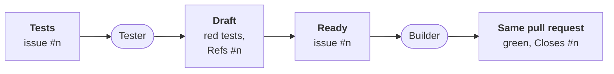

---
sources:
  - internal/kit/testmark/testmark.go#TestsBranch
  - internal/kit/testmark/testmark.go#TestsSubject
  - roles/tester/code/write.go#draftBody
  - roles/tester/code/write.go#unprovenOf
  - roles/tester/code/write.go#proveOnBase
  - roles/tester/code/frozen.go#record
  - internal/kit/testmark/draft.go#DraftData
  - roles/tester/code/frozen.go#record.body
  - roles/tester/code/frozen.go#readRecordKept
  - roles/tester/code/frozen.go#guard
  - roles/developer/code/bounds.go#checker.rule
  - roles/tester/code/green.go#greenRuns
  - roles/tester/code/green.go#judge
  - internal/engine/done.go
checked: e81df7b34
verified: agent:claude-code
---
# The hand-over: what whoever builds finds

Part of [the tester](../README.md). The contract the developer
([ADR-0054](../../../docs/adr/0054-the-developer-takes-a-ready-issue-to-a-pull-request.md))
or a person reads before building a ready issue.

## What is there

- **The branch**: `workline/tester/issue-<n>`, the base plus the
  tester's commit of the tests. The tests are red there.
- **The Draft**: a pull request from that branch, opened by workline's
  account, titled `test: the acceptance tests of #<n>`.
  - It says `Refs #<n>`, never `Closes`: it does not count as a pull
    request closing the issue.
  - `## Tests`: a table, each scenario and the test that checks it;
    a scenario no test can check is listed as not tested, with why.
  - What the proof said: each test red on the base, by an assertion,
    a missing name the issue names, or a broken build the judge read.
    A test whose package did not build is named `file:name`, or by
    its file alone where no `test-name` names its tests, marked so
    ([how](missing-name.md)). **Red unproven**, when the judge did
    not settle it, is written on top, in the record, and on the
    developer's pull request.
  - Where it ran: with `draft-command` naming `{packages}`, the folders
    holding the tests alone, or their build modules with
    `module-files` set, said as `proof-scope`; else the whole
    suite ([#979](https://github.com/JN0V/workline/issues/979)).
- **The record**: workline's own comment on the Draft, marked
  `workline:tester-record`. It holds the issue, the base, each test
  file with its git blob, the test ids the red proof found new, and
  the scenarios as read. Only the tester's runs write it. The green
  proof requires each id on the code ([how](green-proof-tests.md)).

## Before the builder

- **When the tests are written**, and the issue moves on:
  [written](written.md).
- **A proof kind** in place of a test, and **a bug not reproduced**:
  [proof kinds](proof-kinds.md).
- **When the tester refuses an issue**: [refusals](refused.md).

## What the builder does

- **Claims the issue**: a person by the forge's assignment, the
  developer by its label ([the claim](../../developer/docs/pick.md#the-claim));
  the tester assigns nobody.
- **Starts from the branch**: checks it out and pushes its commits on
  top. Never a force push, never a branch of its own for the issue.
  Where the project routes the tester, a ready issue whose Draft is not
  open yet waits for it ([the pick](../../developer/docs/pick.md#which-issue)).
- **The developer** opens a pull request of its own instead,
  `workline/developer/<n>`, on top of the Draft's commits; merged, it
  brings the tests ([its pull request](../../developer/docs/pull-request.md)).
- **Leaves the tests as they are**: a change to the tester's recorded
  lines, or their file's deletion, blocks the merge request
  (`tester-test-changed`). Its own new tests go in other files: its
  bounds keep a frozen file whole, even one the tester only added to.
- **Objects** to a test that does not fit, on the test's line in the
  Draft, not in its own pull request
  ([the form](objections.md)); the tester
  keeps it or rewrites it, on top of the branch. The developer's next
  round takes the rewrite ([tests in a round](../../developer/docs/review-tests.md)).
- **Closes**: once the tests are green, the description says
  `Closes #<n>`, and the Draft is marked ready. It then merges by the
  project's policy
  ([ADR-0042](../../../docs/adr/0042-the-engine-merges-by-the-projects-policy.md)):
  at `normal`, a reproduced bug's fix alone, a feature or a task once a
  person says yes ([the merge](../../developer/docs/merge.md)).
- **Green on the head**: once marked ready, each new test passes on
  the head, run again when red; red in one run only is flaky
  (`test-flaky`), red in both is `test-red-on-head`, and both block
  ([the proof](green-proof.md)).
- **Once merged**: the next push to the base runs `workline follow`, no
  agent. It closes the Draft of the closed issue, its comment naming the
  pull request that closed it (`draft-closed`), and takes the states'
  labels off the issue (`state-cleared`,
  [#999](https://github.com/JN0V/workline/issues/999)).

## Not yet

- A Draft a person closed unmerged is not remembered as refused: a
  later scheduled run may take that issue again
  ([status](status.md#missing)).
