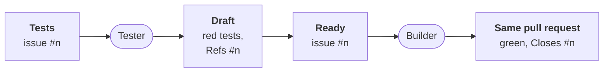

# The hand-over: what whoever builds finds

Part of [the tester](../README.md). The contract the developer
([ADR-0054](../../../docs/adr/0054-the-developer-takes-a-ready-issue-to-a-pull-request.md))
or a person reads before building a ready issue.

## What is there

- **The branch**: `workline/tester/issue-<n>`, the base plus the
  tester's commit of the tests. The tests are red there.
- **The Draft**: a pull request from that branch, opened by workline's
  account, titled `test: the acceptance tests of #<n>`.
  - It says `Refs #<n>`, never `Closes`: it does not count as a pull
    request closing the issue.
  - `## Tests`: a table, each scenario and the test that checks it;
    a scenario no test can check is listed as not tested, with why.
  - What the proof said: each test red on the base, by an assertion or
    a missing name. A test whose package did not build is named
    `file:name` ([how](missing-name.md)).
- **The record**: workline's own comment on the Draft, marked
  `workline:tester-record`. It holds the issue, the base, each test
  file with its git blob, and the scenarios as read. Only the tester's
  runs write it.

## When the tests are written

The issue waits for its tests labelled `workline:needs-tests`, set by
the product owner; an issue labelled ready by hand, with no Draft, is
taken too. Routed on `issue` (`issue: [tester, developer]`), the issue
line runs the tester on it at once
([the line of states](../../../docs/spec/routing.md#the-line-of-states)).
Once the Draft is proven, the engine moves the issue on, no agent asked
([ADR-0059](../../../docs/adr/0059-an-issue-moves-by-its-state-each-step-wakes-the-next.md#3-tests-wakes-the-tester-its-result-makes-ready)):

- **Each scenario** has its row in `## Tests`, or its reason under
  not tested.
- **The project's lint** passes on the tests: each gate routed on
  `merge-request`, only what they add counted. One that does not blocks
  the run (`tests-lint`): no Draft, the issue keeps its state.
- **Then ready**: `workline:ready` on, the other states' labels off,
  said in the tester's comment on the issue (`state-moved`). An issue
  already ready keeps its labels.

## A proof kind, not always a new test

When no new test fits, the tester's agent names the proof that does
([ADR-0059](../../../docs/adr/0059-an-issue-moves-by-its-state-each-step-wakes-the-next.md#4-a-proof-kind-not-always-a-new-test)):

| Kind | When | Proof |
|---|---|---|
| `flaky-n-of-n` | a flaky test to make reliable | the named test passes N runs of N |
| `existing-suite` | a refactor | the project's suite, unchanged and green |
| `docs-checks` | a docs change | the documentalist's checks |

- **Recorded**, the kind and its reason, in the tester's comment on the
  issue; no Draft. The issue moves to ready (`proof-recorded`); one
  labelled ready by hand keeps its state.
- **The developer** takes it as it takes one with a Draft, the kind in
  its task ([the pick](../../developer/docs/pick.md#which-issue)).
- **`none`**, no test possible: the issue goes back to the product
  owner's state, refine, the reason said and recorded
  (`no-test-possible`). The product owner then picks a kind, or sends
  it back to its tests
  ([refine](../../../docs/spec/backlog-acts/refine.md#no-test-possible-a-proof-kind-picked));
  with no agent, a person of the project names one in a comment,
  `proof: <kind> — why`.
- **`flaky-n-of-n` names its test**, `test: <name>` under the note,
  and its runs, `runs: <N>`; both kept in the record. The developer's
  proof runs that test N times
  ([N runs of N](../../developer/docs/proof.md#a-flaky-test-n-runs-of-n)).
- **Refused**: a kind it does not know (`proof-kind-unknown`), one with
  no reason (`proof-reason-missing`), a `flaky-n-of-n` naming no test
  (`proof-test-missing`); the issue keeps its state.

## When the tester refuses an issue

`workline test write --issue <n>` on an issue neither waiting for its
tests nor ready, or whose
Validation names no scenario, blocks before any agent is asked. The
refusal is written on the issue too
([ADR-0059](../../../docs/adr/0059-an-issue-moves-by-its-state-each-step-wakes-the-next.md#1-every-refusal-claim-wait-or-block-is-on-the-issue)):

- **One comment of the tester's**, edited on each refusal: why, and
  what comes next (ready it, or name its scenarios).
- **Its own tests refused too**: a test green on the base, a scenario
  with no test, no test written: said in the same comment, the run
  still blocks.
- **An answer that does not read** (a list item indented one space
  too far): asked again once, with the reader's error; still
  unreadable, refused and said, no third call
  ([#761](https://github.com/JN0V/workline/issues/761)).
- **Not a job's log alone**: a person on the issue sees why no Draft
  came.

## What the builder does

- **Claims the issue**: a person by the forge's assignment, the
  developer by its label ([the claim](../../developer/docs/pick.md#the-claim));
  the tester assigns nobody.
- **Starts from the branch**: checks it out and pushes its commits on
  top. Never a force push, never a branch of its own for the issue.
  Where the project routes the tester, a ready issue whose Draft is not
  open yet waits for it.
- **The developer** opens a pull request of its own instead,
  `workline/developer/<n>`, on top of the Draft's commits; merged, it
  brings the tests ([its pull request](../../developer/docs/pull-request.md)).
- **Leaves the tests as they are**: a change to a recorded file, or its
  deletion, blocks the merge request (`tester-test-changed`). Its own
  new tests go in other files.
- **Objects** to a test that does not fit, on the test's line
  ([the form](../README.md#frozen-tests-and-objections)); the tester
  keeps it or rewrites it, on top of the branch.
- **Closes**: once the tests are green, the description says
  `Closes #<n>`, and the Draft is marked ready. It then merges by the
  project's policy
  ([ADR-0042](../../../docs/adr/0042-the-engine-merges-by-the-projects-policy.md)).
- **Green three times**: once marked ready, each new test passes on the
  head three runs out of three; one red is flaky and blocks
  (`test-flaky`, [the proof](green-proof.md)).

## Not yet

- A Draft a person closed unmerged is not remembered as refused: a
  later scheduled run may take that issue again
  ([status](status.md#missing)).
