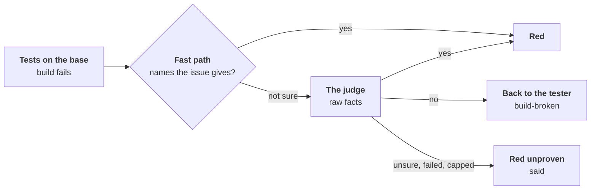

---
sources:
  - roles/tester/code/tester.go#prove
  - roles/tester/code/tester.go#Check
  - roles/tester/code/tester.go#unbuiltTests
  - roles/tester/code/redfirst.go#redFirst.lacks
  - roles/tester/code/redfirst.go#redFirst.named
  - roles/tester/code/redfirst.go#redFirst.fast
  - roles/tester/code/build.go#namedIn
  - roles/tester/code/judged.go#doubt.waiting
  - roles/tester/code/junit.go#readJUnit
checked: e81df7b34
verified: agent:claude-code
---
# A broken build, red for the right reason

Part of [the tester](../README.md). A test written before its code
calls names the code lacks. In a compiled language the test's package
then does not build: the report holds no new test, only the runner's
record of the failed build. Whether that is red for the right reason is
read from facts, then judged
([ADR-0065](../../../docs/adr/0065-code-only-what-converges-language-knowledge-in-packs.md#1-red-for-the-right-reason-goes-to-judgement)).

- **[The judge](build-judge.md)**: what it is asked, what it reads, its
  three answers.
- **[What follows](build-outcomes.md)**: the Draft, red unproven, the
  agent asked once more.
- **[The build-errors setting](build-errors.md)**: the rows, the
  defaults, other languages, the lint.

## The rule

- **Kept mechanical**: the runs, the report, whether the build broke,
  the error lines the `build-errors` rows read, and whether the base
  holds a name (`git grep -w`).
- **No report**: a build that stops at compiling the tests, as Gradle
  does, writes none. The compiler's lines are read first
  ([#1192](https://github.com/JN0V/workline/issues/1192)).
- **The fast path, red at once**: each error lies in the change's tests,
  is a missing name a row reads (`undefined: Mul`, `Unresolved reference
  'mul'`), the base lacks it, and the issue names it verbatim, as a whole
  word or its last part (`lostCount` for `MQTTStatistics::lostCount`).
  The summary says so: `a missing name the issue names`. Sure of a yes,
  or it hands the facts on: it never blocks.
- **Anything else goes to [the judge](build-judge.md)**
  ([ADR-0045](../../../docs/adr/0045-the-judge-asks-for-the-code-it-needs.md)):
  a changed signature, a name the issue never names, a wrong call, a
  syntax error. No compiler message is guessed at.
- **No issue known** (`workline test check`): a name the change's code
  adds counts as named; with the tests alone, nothing does.

## The run's other cases

- **A person's tests, no agent** (`workline test check`): no judge runs.
  Past the fast path, the check ends `human`, `red-unproven`, its lines
  quoted: the only case a person is waited for.
- **No report and no error a row reads**: `report-missing`
  ([what it quotes](build-judge.md#no-report), [what follows](build-outcomes.md#asked-again)).
- **A module with no test yet**: on the base, no report and exit 0, as
  Gradle's `NO-SOURCE`, is an empty run, no test green there. Exiting
  non-zero, it is `report-missing`
  ([#2091](https://github.com/JN0V/workline/issues/2091)).
- **The tests' names**, when nothing built them: read from the test
  files, as `file:name` (`calc/mul_test.go:TestMulTwoByThree`).
  - A test the base's report names, in a file the tests were added to,
    is the base's, never a new one.
  - A row with no `test-name` (C, the generic pack): each test file the
    change adds that the build broke on is one test, named by its file,
    which proves only that the file is there (a helper with no error in
    it is no test;
    [what the green proof wants](build-outcomes.md#a-test-named-by-its-file)).
- **JUnit 5 on Gradle** reports `two by three()`: the `()` is dropped,
  the name as its file writes it
  ([#1178](https://github.com/JN0V/workline/issues/1178)).
- **Beside code**, the head builds and runs those tests: they must pass
  there, as any new test. A test file that does not build on the head
  but for a missing name is `build-broken`, its lines quoted, never
  the code's red ([#1283](https://github.com/JN0V/workline/issues/1283)).
- **No error line read**, in a language with no rows set: as before,
  `tests-not-built` warns ([what follows](build-outcomes.md#no-error-line-read)).

## Limits

- **Case counts**: `lostcount` in the issue does not name `lostCount`:
  the judge reads it.
- **A common word**: a made-up name that is also a word of the issue's
  prose (`get`, `init`, `lost`), and the base lacks, passes the fast
  path, since a whole word matches.
- **`workline test check`** with the tests alone knows no issue: a
  broken build there is always red unproven, for a person.
- **The base's words**: "a name the base lacks" is a whole-word search
  of the base's files; a word in a comment there counts as held, and
  the judge reads it.
- **Go stops at ten errors** a package (`too many errors`): the errors
  past the tenth are not read. `-gcflags=-e` in the test command shows
  them all.
- **The judge's tokens**: asked only past the fast path; measured on a
  real build ([what a call spent](../../../docs/research/token-costs-measured.md#tester)).
