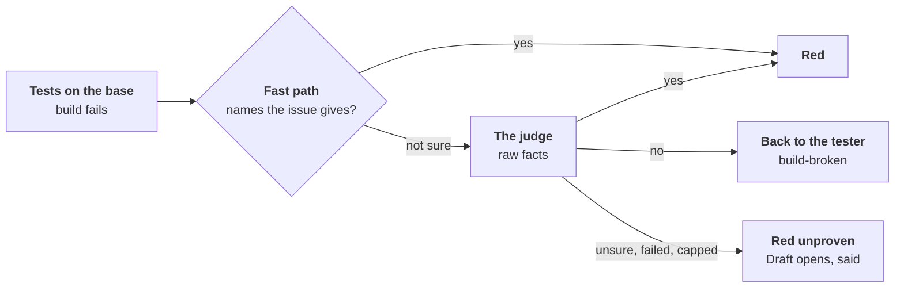

# A broken build, red for the right reason

Part of [the tester](../README.md). A test written before its code
calls names the code lacks. In a compiled language the test's package
then does not build: the report holds no new test, only the runner's
record of the failed build. Whether that is red for the right reason is
read from facts, then judged
([ADR-0065](../../../docs/adr/0065-code-only-what-converges-language-knowledge-in-packs.md#1-red-for-the-right-reason-goes-to-judgement)).

## The rule

- **Kept mechanical**: the runs, the report, whether the build broke,
  the error lines the `build-errors` rows read, and whether the base
  holds a name (`git grep -w`).
- **No report**: a build that stops at compiling the tests, as Gradle
  does, writes none. The compiler's lines are read first
  ([#1192](https://github.com/JN0V/workline/issues/1192)).
- **The fast path, red at once**: each error lies in the change's tests,
  is a missing name a row reads (`undefined: Mul`, `Unresolved reference
  'mul'`), the base lacks it, and the issue names it verbatim, as a whole
  word or its last part (`lostCount` for `MQTTStatistics::lostCount`).
  The summary says so: `a missing name the issue names`. Sure of a yes,
  or it hands the facts on: it never blocks.
- **Anything else goes to the judge**
  ([ADR-0045](../../../docs/adr/0045-the-judge-asks-for-the-code-it-needs.md)):
  a changed signature, a name the issue never names, a wrong call, a
  syntax error. No compiler message is guessed at.
- **No issue known** (`workline test check`): a name the change's code
  adds counts as named; with the tests alone, nothing does.

## The judge

- **Asked**: "Does each test fail only because what the issue asks for
  does not exist yet, and not by a mistake of its own?"
- **What it reads, raw**: the issue's text, its Scope and scenarios; the
  change's test files; the compiler's lines and the output's end,
  clipped and masked, the checkout's folder taken off their paths; and,
  for each name the errors give, whether the base holds it.
- **Asked once a run on the same facts**: the agent asked again writes
  the same tests, broken the same way: the judge's first answer stands,
  said on the finding. Other tests or other errors: it is asked again.
- **It may read the base first**: a file's lines, a definition, a word's
  places, served from git (`judge-read-rounds`, 2; `judge-read-lines-max`,
  400). Either at 0: it answers from the facts alone.
- **The proof kept while it reads** lost (unreadable): the run fails
  once, said; the judge is not asked again.
- **Picked** at the best independence from the tester's agent
  ([ADR-0005](../../../docs/adr/0005-independence-takes-the-best-level-available.md));
  `WORKLINE_JUDGE` names one. Its calls count in the tester's
  `ai-max-tokens`.

| The judge | The run |
|---|---|
| yes | red: the Draft opens, `red-judged` says why |
| no | `build-broken`, the judge's line quoted; the agent is asked once more |
| unsure, past its reads, failed, or at the tokens' cap | **red unproven**: the Draft opens, marked |

- **Red unproven** is written on the Draft, its body and its record,
  with the compiler's lines and the judge's reason; the issue moves to
  ready, and the developer starts. Its pull request says it too. The
  green proof on the code and the
  [objection chain](../../../docs/adr/0059-an-issue-moves-by-its-state-each-step-wakes-the-next.md)
  settle it: never a pass unsaid, never a stuck run.
- **A test rewritten on an objection** is proven again: red unproven,
  its reply and the record say why.
- **A person's tests, no agent** (`workline test check`): no judge runs.
  Past the fast path, the check ends `human`, `red-unproven`, its lines
  quoted: the only case a person is waited for.
- **No report and no error a row reads**: `report-missing`, its error
  lines quoted, not the build tool's last ones (`BUILD FAILED`). On the
  tests' run, the agent is asked once more; on the base alone, final.
- **The tests' names**, when nothing built them: read from the test
  files, as `file:name` (`calc/mul_test.go:TestMulTwoByThree`). A
  test the base's report names, in a file the tests were added to, is
  the base's, never a new one. A row with no `test-name` (C, the
  generic pack): each test file the change adds that the build broke
  on is one test, named by its file, which proves only that the file is
  there (a helper with no error in it is no test); the green proof
  then wants a test of it, green
  ([#1293](https://github.com/JN0V/workline/issues/1293)).
- **Beside code**, the head builds and runs those tests: they must pass
  there, as any new test. A test file that does not build on the head
  but for a missing name is `build-broken`, its lines quoted, never
  the code's red ([#1283](https://github.com/JN0V/workline/issues/1283)).
- **No error line read**, in a language with no rows set: as before,
  `tests-not-built` warns, and `test write` opens no Draft.

## The setting

`build-errors`, a list, one item an ecosystem:

| Key | |
|---|---|
| `error` | a regular expression matching one error line of the test command's output, with groups `file` and `message` |
| `missing-name` | the messages naming what the code lacks; the name in a group `name`, else the message's first quoted word (`‘lostCount’`) |
| `name-line` | optional: a later line giving the name a missing-name message lacks, in its group `name`; read up to the next error line |
| `message-line` | optional: a later line giving the message an error line lacks, in its group `message`; read up to the next error line, quoted with it |
| `test-name` | finds the tests a test file declares; its first group that matched is the name; empty, the row names no tests |

- **The file, from the repository's root**: an absolute path or a
  `file://` URI under the folder the tests ran in is read from there,
  as Gradle prints Kotlin's and javac's errors
  ([#1177](https://github.com/JN0V/workline/issues/1177)). On Windows
  too: `file:///C:/…` and `C:\…` alike, the case not counted
  ([#1183](https://github.com/JN0V/workline/issues/1183)).
- **A wrong pattern** blocks before any run (`setting-invalid`).
- **Set in a project**, the list replaces the defaults whole.

## The defaults

In [role.yaml](../role.yaml), each tried on a real build:

| Ecosystem | Error line | Missing name |
|---|---|---|
| Go | `calc/mul_test.go:6:5: undefined: Mul` | `undefined`, `has no field or method`, `unknown field` |
| Kotlin, by Gradle | `e: file:///…/MulTest.kt:10:25 Unresolved reference 'mul'.`; Kotlin 1's `e: /…/MulTest.kt: (10, 25): …` | `Unresolved reference`, `No parameter with name` |
| Java (`javac`) | `/…/MulTest.java:9: error: cannot find symbol` | `cannot find symbol` |
| Gradle build files | `Build file '/…/build.gradle' line: 3` | none: the judge reads it |
| pytest | `___ ERROR collecting tests/test_pricing.py ___`, then `E   ImportError: …` | `cannot import name`; a module not found goes to the judge |

- **Kotlin's tests**: `@Test fun `two by three`()` or `@Test fun
  twoByThree()`, named without the backquotes.
- **pytest's message** is on its first `E` line under the file it
  could not collect, read by its `message-line`
  ([#1283](https://github.com/JN0V/workline/issues/1283)).
- **javac's name** is on a later line (`symbol: method mul(int,int)`),
  read by its `name-line`, then checked against the issue's text.
- **Data, not engine code**: these rows stay in role.yaml until the
  language packs take them
  ([#1230](https://github.com/JN0V/workline/issues/1230)).
- **A path with a space** is read, Kotlin 1's and javac's plain paths
  too.
- **JUnit 5 on Gradle** reports `two by three()`: the `()` is dropped,
  the name as its file writes it
  ([#1178](https://github.com/JN0V/workline/issues/1178)).

## Other languages

The same rule; their error shapes, from each compiler's documentation,
not tried yet.

| Language | Missing name | Shape |
|---|---|---|
| TypeScript (`tsc`) | `TS2304 Cannot find name`, `TS2339 Property … does not exist on type` | one line: `file(line,col): error TS2304: …` |
| C# | `CS0103` (a name), `CS1061` (a member) | one line: `file(line,col): error CS0103: …` |
| Rust | `E0425` (a value), `E0599` (a method), `E0433` (a path) | two lines: `error[E0425]: …`, then ` --> file:line:col` |
| Java by Maven | `cannot find symbol` | one line: `[ERROR] /…/X.java:[9,25] cannot find symbol` |

- **One-line shapes** (TypeScript, C#, Maven): set `build-errors` with
  their patterns. A message whose first quoted word is the missing name
  (`Cannot find name 'lostCount'`) needs no group `name`.
- **Something else quoted first** needs a group `name`. C#'s CS1061,
  `'Stats' does not contain a definition for 'lostCount'`, quotes the
  type first: match it with `definition for '(?P<name>\w+)'`.
- **Several lines** (Rust): one line does not hold both the file and
  the message, so these are not read yet. `cargo
  --message-format=json` would give both in one record.

## The lint

The tests pass the project's lint before the Draft opens
([hand-over](hand-over.md)). A lint that type-checks, as
golangci-lint does, reports the same missing name
([#988](https://github.com/JN0V/workline/issues/988)):

- **Not counted**: a lint finding read by `build-errors` as a missing
  name, or as one of the build's own errors in a test of the change,
  which the proof reads or the judge does. golangci-lint puts the
  compiler's lines in its message (`calc/mul_test.go:8:5: undefined:
  Mul`), at the package's first file: each line must be one.
- **Still counted**: any other finding, a format check's too.
- **Seen later**: golangci-lint runs no other linter on a package that
  does not build. An unchecked error in the test shows only once the
  code exists, on the builder's merge request.

## Limits

- **Case counts**: `lostcount` in the issue does not name `lostCount`:
  the judge reads it.
- **A common word**: a made-up name that is also a word of the issue's
  prose (`get`, `init`, `lost`), and the base lacks, passes the fast
  path, since a whole word matches.
- **`workline test check`** with the tests alone knows no issue: a
  broken build there is always red unproven, for a person.
- **The base's words**: "a name the base lacks" is a whole-word search
  of the base's files; a word in a comment there counts as held, and
  the judge reads it.
- **Go stops at ten errors** a package (`too many errors`): the errors
  past the tenth are not read. `-gcflags=-e` in the test command shows
  them all.
- **The judge's tokens**: asked only past the fast path; measured on a
  real build on [#1252](https://github.com/JN0V/workline/pull/1252#tried): 2k to 7.5k tokens in a call.
