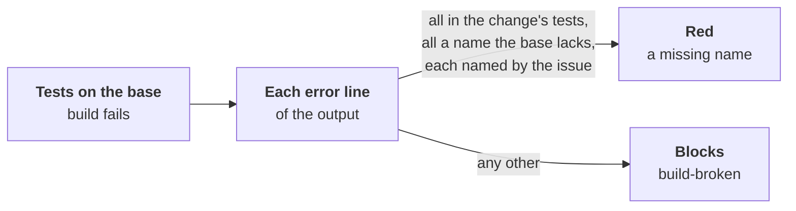

# A missing name, told from a broken build

Part of [the tester](../README.md). A test written before its code
calls names the code lacks. In a compiled language the test's package
then does not build: the report holds no new test, only the runner's
record of the failed build.

## The rule

- **Red, for the right reason**, only when every error the compiler
  printed:
  - lies in a test file the change adds or changes, and
  - names something the base lacks: `undefined: Mul`, `v.Scale undefined
    (type T has no field or method Scale)`, `unknown field Rate in struct
    literal`, and
  - that name is in the issue's text (title and body) as a whole word,
    or its last part (`lostCount` for `MQTTStatistics::lostCount`): what
    the change adds
    ([#1111](https://github.com/JN0V/workline/issues/1111)).
- **Any other error blocks** (`build-broken`): a syntax error, a wrong
  import, a call with the wrong arguments, an error in a code file, a
  helper the test made up (`stubSetBrokerLink`, named nowhere in the
  issue). The check names the lines and the made-up names. Writing an
  issue's tests, the agent is asked once more with them first.
- **The tests' names**, when nothing built them: read from the test
  files, as `file:name` (`calc/mul_test.go:TestMulTwoByThree`).
- **Beside code**, the head builds and runs those tests: they must pass
  there, as any new test.
- **No error line read**, in a language with no patterns set: as before,
  `tests-not-built` warns, and `test write` opens no Draft.

## The setting

`build-errors`, a list, one item an ecosystem:

| Key | |
|---|---|
| `error` | a regular expression matching one error line of the test command's output, with groups `file` and `message` |
| `missing-name` | the messages naming what the code lacks; the name in a group `name`, else the message's first quoted word (`‘lostCount’`) |
| `test-name` | finds the tests a test file declares; its first group that matched is the name; empty, the row names no tests |

- **The file, from the repository's root**: an absolute path or a
  `file://` URI under the folder the tests ran in is read from there,
  as Gradle prints Kotlin's and javac's errors
  ([#1177](https://github.com/JN0V/workline/issues/1177)).
- **A wrong pattern** blocks before any run (`setting-invalid`).
- **Set in a project**, the list replaces the defaults whole.

## The defaults

In [role.yaml](../role.yaml), each tried on a real build:

| Ecosystem | Error line | Missing name |
|---|---|---|
| Go | `calc/mul_test.go:6:5: undefined: Mul` | `undefined`, `has no field or method`, `unknown field` |
| Kotlin, by Gradle | `e: file:///…/MulTest.kt:10:25 Unresolved reference 'mul'.`; Kotlin 1's `e: /…/MulTest.kt: (10, 25): …` | `Unresolved reference`, `No parameter with name` |
| Java (`javac`) | `/…/MulTest.java:9: error: cannot find symbol` | `cannot find symbol` |
| Gradle build files | `Build file '/…/build.gradle' line: 3` | none: it blocks |

- **Kotlin's tests**: `@Test fun `two by three`()` or `@Test fun
  twoByThree()`, named without the backquotes.
- **javac's name** is on a later line (`symbol: method mul(int,int)`):
  not read, so the issue's text is not checked for it.
- **JUnit 5 on Gradle** reports `two by three()`: the `()` is dropped,
  the name as its file writes it
  ([#1178](https://github.com/JN0V/workline/issues/1178)).

## Other languages

The same rule; their error shapes, from each compiler's documentation,
not tried yet.

| Language | Missing name | Shape |
|---|---|---|
| TypeScript (`tsc`) | `TS2304 Cannot find name`, `TS2339 Property … does not exist on type` | one line: `file(line,col): error TS2304: …` |
| C# | `CS0103` (a name), `CS1061` (a member) | one line: `file(line,col): error CS0103: …` |
| Rust | `E0425` (a value), `E0599` (a method), `E0433` (a path) | two lines: `error[E0425]: …`, then ` --> file:line:col` |
| Java by Maven | `cannot find symbol` | one line: `[ERROR] /…/X.java:[9,25] cannot find symbol` |

- **One-line shapes** (TypeScript, C#, Maven): set `build-errors` with
  their patterns. A message whose first quoted word is the missing name
  (`Cannot find name 'lostCount'`) needs no group `name`.
- **Something else quoted first** needs a group `name`. C#'s CS1061,
  `'Stats' does not contain a definition for 'lostCount'`, quotes the
  type first: match it with `definition for '(?P<name>\w+)'`.
- **Several lines** (Rust): one line does not hold both the file and
  the message, so these are not read yet. `cargo
  --message-format=json` would give both in one record.

## The lint

The tests pass the project's lint before the Draft opens
([hand-over](hand-over.md)). A lint that type-checks, as
golangci-lint does, reports the same missing name
([#988](https://github.com/JN0V/workline/issues/988)):

- **Not counted**: a lint finding read by `build-errors` as a missing
  name in a test of the change. golangci-lint puts the compiler's lines
  in its message (`calc/mul_test.go:8:5: undefined: Mul`), at the
  package's first file: each line must be a missing name.
- **Still counted**: any other finding, a format check's too.
- **Seen later**: golangci-lint runs no other linter on a package that
  does not build. An unchecked error in the test shows only once the
  code exists, on the builder's merge request.

## Limits

- **A name not read**: a message with no group `name` and no quoted
  word counts as red, as before: the issue's text is not checked.
- **Case counts**: `lostcount` in the issue does not name `lostCount`.
- **A common word**: a made-up name that is also a word of the issue's
  prose (`get`, `init`, `lost`) counts as red, since a whole word
  matches.
- **`workline test check`** on a pull request knows no issue: any
  missing name counts.
- **Go stops at ten errors** a package (`too many errors`): the errors
  past the tenth are not read. `-gcflags=-e` in the test command shows
  them all.
- **A new package's import** (`package … is not in std`) is not counted
  as a missing name: it blocks.
