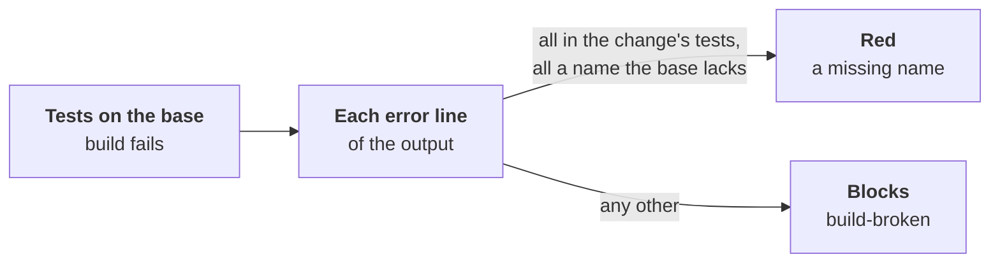

# A missing name, told from a broken build

Part of [the tester](../README.md). A test written before its code
calls names the code lacks. In a compiled language the test's package
then does not build: the report holds no new test, only the runner's
record of the failed build.

## The rule

- **Red, for the right reason**, only when every error the compiler
  printed:
  - lies in a test file the change adds or changes, and
  - names something the base lacks: `undefined: Mul`, `v.Scale undefined
    (type T has no field or method Scale)`, `unknown field Rate in struct
    literal`.
- **Any other error blocks** (`build-broken`): a syntax error, a wrong
  import, a call with the wrong arguments, an error in a code file. The
  check names the lines.
- **The tests' names**, when nothing built them: read from the test
  files, as `file:name` (`calc/mul_test.go:TestMulTwoByThree`).
- **Beside code**, the head builds and runs those tests: they must pass
  there, as any new test.
- **No error line read**, in a language with no patterns set: as before,
  `tests-not-built` warns, and `test write` opens no Draft.

## The setting

`build-errors`, a list, one item an ecosystem:

| Key | |
|---|---|
| `error` | a regular expression matching one error line of the test command's output, with groups `file` (from the repository's root) and `message` |
| `missing-name` | the messages naming what the code lacks |
| `test-name` | finds the tests a test file declares; its first group is the name |

Go's is the default, in [role.yaml](../role.yaml). A wrong pattern
blocks before any run (`setting-invalid`).

## Other languages

The same rule; their error shapes, from each compiler's documentation.
Only Go's is built and tested.

| Language | Missing name | Shape |
|---|---|---|
| TypeScript (`tsc`) | `TS2304 Cannot find name`, `TS2339 Property … does not exist on type` | one line: `file(line,col): error TS2304: …` |
| C# | `CS0103` (a name), `CS1061` (a member) | one line: `file(line,col): error CS0103: …` |
| Rust | `E0425` (a value), `E0599` (a method), `E0433` (a path) | two lines: `error[E0425]: …`, then ` --> file:line:col` |
| Java (`javac`) | `cannot find symbol` | the file first, the symbol on later lines |

- **One-line shapes** (TypeScript, C#): set `build-errors` with their
  patterns.
- **Several lines** (Rust, Java): one line does not hold both the file
  and the message, so these are not read yet. `cargo
  --message-format=json` would give both in one record.

## Limits

- **Go stops at ten errors** a package (`too many errors`): the errors
  past the tenth are not read. `-gcflags=-e` in the test command shows
  them all.
- **A new package's import** (`package … is not in std`) is not counted
  as a missing name: it blocks.
