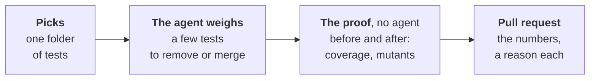

# The curator's removals

Part of [the tester](../README.md). Step 7 of
[ADR-0055's plan](../../../docs/adr/0055-the-tester-writes-the-acceptance-tests-before-the-code.md#build-plan):
a few redundant tests removed a week, each removal proven with no agent,
opened as a pull request the project's merge policy merges. The measures
it weighs: [the curator's measures](curator.md).

## A run

`workline test curate --history <file> --ai claude`, on `HEAD`:

- **One folder of tests**: the largest, by lines, that fits
  `code-lines-max`, among the files `curator-paths` names; not one an
  open curator pull request holds, nor one weighed within
  `curator-window` measures (kept in the history).
- **The agent reads** that folder's test files whole, and each test's
  measures: time, runs, red runs, never red.
- **The agent proposes** at most `curator-removals-max` tests removed
  or merged: redundant (another checks the same behaviour on the same
  code), slow and dominated by a faster one, one scenario tested twice.
  A note a test: the test that keeps its check, and why.
- **The agent is a choice**: none, `claude`, `cmd:<any command>`. With
  none, nothing is removed (`no-agent`).

## The proof, no agent

In one checkout of `HEAD`, the touched folders only, within
`curator-proof-seconds`:

- **Before**: `curator-proof-command` on `{packages}`, the touched
  folders: its JUnit report and its coverage (`coverage-report`); then
  `curator-mutation-command` on each folder (`{package}`), its report.
- **After**: the agent's patches laid, the same again.
- **Holds when**: green before and after; at least one test fewer, no
  more than `curator-removals-max`; no line covered before and not
  after; no mutant killed before and not after; each test removed named
  in a note.
- **The pull request**: branch `workline/tester/curate-<folder>`, not a
  Draft; the tests, their time, coverage and mutants killed, before and
  after; each test removed, and why. The reviewer reads it; the merge
  policy merges it ([ADR-0042](../../../docs/adr/0042-the-engine-merges-by-the-projects-policy.md)).

| Finding | Nothing proposed when |
|---|---|
| `coverage-lost` | a line covered before is not after |
| `mutant-lost` | a mutant killed before is not after |
| `red-before`, `red-after` | a test of the folders red in a run |
| `nothing-removed`, `too-many-removed` | no test fewer, or over `curator-removals-max` |
| `removal-unexplained` | a test removed no note names |
| `test-frozen` | a test file the tester's open Draft records ([frozen](../README.md#frozen-tests-and-objections)) |
| `test-kept` | a file or test a `curator-keep` file lists |
| `curator-path` | a file outside `curator-paths` |
| `proof-over-time` | the proof past `curator-proof-seconds`: stopped |
| `setting-missing` | no `coverage-report`, or no mutation command where the language has a tool: the agent is not called |

## Mutation, by ecosystem

The report read is Gremlins' JSON or the
[mutation testing report schema](https://github.com/stryker-mutator/mutation-testing-elements/tree/master/packages/report-schema)
(Stryker, and the tools writing it).

| Language | `curator-mutation-command` |
|---|---|
| Go | `go run github.com/go-gremlins/gremlins/cmd/gremlins@v0.6.0 unleash -s -o {report} {package}` |
| JavaScript, TypeScript | `npx stryker run` with the JSON reporter, `curator-mutation-report` set to its file |
| Another | `none`: coverage alone, said in the pull request |

## Settings

| Key | Default | |
|---|---|---|
| `curator-paths` | `test-paths` | the test files it may change; leave out a test whose coverage the report cannot see (one running a built binary) |
| `curator-keep` | none | files listing tests never removed, a name a line |
| `curator-removals-max` | 5 | tests a run removes at most |
| `curator-proof-command` | `curator-command`, else `test-command` | the proof's run, `{packages}` the touched folders |
| `curator-mutation-command` | none | on each touched folder, `{package}`, writing `{report}` |
| `curator-mutation-report` | `mutation.json` | where it writes |
| `curator-proof-seconds` | 1800 | the proof's time budget |

## In CI

Weekly, in the curator's job ([curator.md](curator.md#in-ci)), when the
project gives Claude's token too:

- **GitHub**: the `curator` job runs `test curate --no-apply` after the
  measure; the gardening's `apply` job, with the write token and no
  agent's key, opens the pull request.
- **GitLab**: `workline:curator:judge` then `workline:curator:apply`.
- **Your mutation tool**: in the image, or fetched by the command
  (`go run …@v0.6.0`).

## Its cost, on workline

On a copy of workline, 2026-10-28, a real agent (Claude, standard tier),
the proof with gotestsum and Gremlins v0.6.0 (the try is told in the
pull request [status](status.md) links):

- **Its own tests, three folders** (`internal/engine`, `internal/scale`,
  `internal/agent`): nothing redundant, each said with its reason;
  14 to 25 thousand tokens in, under 900 out, 7 to 10 s a run.
- **A duplicate planted** in `internal/scale` (a test whose check
  another already makes): found and removed; 15 thousand tokens in,
  1,100 out. The proof: 32 s; 20 tests to 19, coverage 94.7 % of 339
  statements both times, 141 of 173 mutants killed both times.
- **A folder over the context budget** (`internal/forge`, 2,669 lines,
  with `code-lines-max` raised): the agent is not asked, said.
