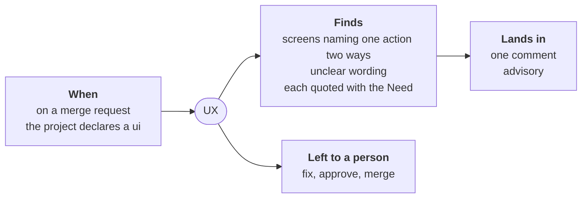

# UX

For people: what the role does and how to set it. The AI never reads this
file. All roles: [docs/roles.md](../../docs/roles.md).

**Does**:

- reads a change's screens against the Need of the issue it closes, and
  flags what accessibility tools cannot judge: screens that name the same
  action two ways, an unclear message;
- quotes each finding, the screen's text or markup and the Need
  ([ADR-0048](../../docs/adr/0048-the-agent-reads-the-pages-the-reader-checks-flag.md));
- stays advisory: tools passing, the verdict stays a pass; tools failing,
  it stays failed
  ([ADR-0061](../../docs/adr/0061-the-ux-role-reads-what-the-accessibility-tools-cannot.md)).

**Does not**: patch, label, approve, or change the gate's verdict.

**Without an agent**: the accessibility checks run, no reading is made
(`without-ai: pass`).

**The agent** is a choice: none, `claude`, `cmd:<any command>`.

**Settings**: `findings-max` (10), findings shown a run.

**Audit**: the auditor can sample the role's acts.

Where it stands: [status](docs/status.md).
